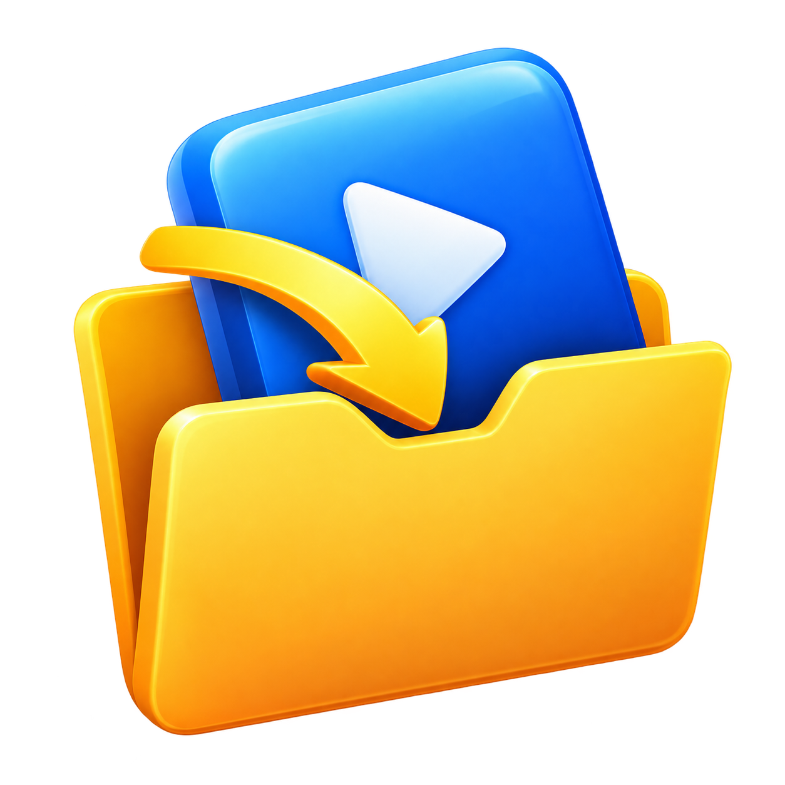

<h1 align="center"> <big>Yolbulan</big></h1>

A Windows app that sorts videos into folders based on filenames or locally analyzed speech.

Yolbulan, Windows'ta videoları dosya adı kurallarına veya konuşmalarının içeriğine göre alt klasörlere ayırır. Taşıma öncesinde sonucu gösterir ve onay ister. Konuşmaları yerel Whisper yazıya döker; yerel ağdaki LM Studio metin modeli içerik tanımlarına göre değerlendirir. Video ve transkript harici analiz servisine gönderilmez.

## Başlatma

Windows'ta Microsoft Edge WebView2 Runtime kurulu olmalıdır. ZIP'i çıkarıp `KUR_VE_BASLAT.cmd` dosyasını çalıştırın. İlk açılışta Python bağımlılıkları kurulur. Arayüz dosyaları pakette hazır gelir ve arayüz çevrimdışı açılır. Kaynak klasörü seçip adları tarayın. Varsayılan kompakt liste dosya adını, süreyi ve önerilen klasörü gösterir. Görselli liste gerçek video karelerini gösterir. Seçilen videonun önizlemesi, transkripti ve hedef klasörü sağ bölmededir.

Görünüm varsayılan olarak Windows temasını izler. Ayarlar’daki Görünüm alanından Açık veya Koyu temayı seçip kaydedebilirsiniz.

## Windows EXE derleme

Windows'ta `DERLE.cmd` dosyasını çalıştırın. Çıktı `dist\Yolbulan\Yolbulan.exe` olur. EXE portatiftir: ayarlar ve transkriptler **EXE'nin yanındaki `calisma_verisi`** klasöründe tutulur. Başka bilgisayara taşırken `dist\Yolbulan` klasörünün tamamını kopyalayın. `ffmpeg.exe` pakete eklenmez; mevcut ses çözümü PyAV kullandığı için harici `ffmpeg.exe` çağrılmaz.

React arayüzünü değiştirirseniz `frontend` klasöründe `npm ci` ve `npm run build` komutlarını çalıştırın. Bu işlem pakete alınan `frontend/assets` dosyalarını günceller. Hazır arayüzü Windows paketine almak için `DERLE.cmd` yeterlidir.

Kurallar, modlar, transkript, CUDA kurulumu, derleme ve geri alma: [KULLANIM.md](KULLANIM.md).

## Lisans

MIT
